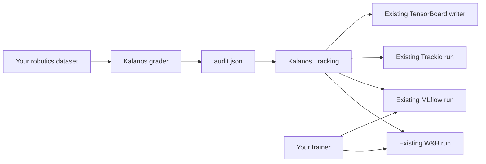

# Kalanos Tracking

### Put dataset evidence beside your training curves.

A lightweight bridge from a **saved Kalanos assessment** to an existing **Weights & Biases, MLflow, Trackio or TensorBoard run**. For robotics engineers preparing imitation-learning experiments, it answers a question a loss curve cannot: **what did we actually check about the data used for this run?**

[Quickstart](#start-in-three-steps) · [W&B](#weights--biases) · [MLflow](#mlflow) · [Private setups](#your-data-your-tracking-destination) · [Integration guide](docs/INTEGRATION.md)



**Separate package. No grader modifications. No MCP. No automatic grading or training.**

> **Source preview:** install from this repository; there is no PyPI release yet. See [validation](VALIDATION.md) for exactly what was tested.

## Make experiments easier to understand

| Question | What appears with your experiment |
|---|---|
| What assessment did we use? | Report SHA-256, grader version, assessment run ID and available source revision/digest. |
| How many episodes need attention? | Separate pass, review, blocked and unknown counts. |
| Is the readiness score established? | Recorded score only when defined, plus an explicit `readiness_defined` flag. |
| What was the assessment scope? | Requirements/policy identifiers, tier, completion and sufficiency status. |
| Can I inspect the evidence later? | Optional summary artifact or explicitly selected full original report. |

A descriptive score is **not** training readiness. Readiness is relative to recorded requirements, and neither is a measured prediction of policy success. A parent dataset's report does not automatically describe a filtered training subset.

## Start in three steps

**Requirements:** Python 3.10+, a local Kalanos report and an existing tracker run.

### 1. Install from the repository checkout

After downloading this source package, run from its root:

```bash
python -m pip install '.[wandb]'       # W&B only
# or
python -m pip install '.[mlflow]'      # MLflow only
# or
python -m pip install '.[wandb,mlflow,trackio,tensorboard]'
```

The adapter pins `kalanos==0.9.3` for its validated report loader. Tracker dependencies are optional. Use an isolated environment compatible with your trainer; freeze resolved versions for production.

### 2. Grade once, then reuse the report

```bash
kalanos grade ./dataset --report audit.json
```

This command can return a nonzero status when the dataset fails the configured gate. A report may still exist: logging that report does **not** override the grader's outcome. Run grading in your existing data-preparation or CI workflow; do not grade every training batch.

### 3. Attach it to your training run

#### Weights & Biases

```python
import wandb
from kalanos_tracking import load_assessment, log_to_wandb

assessment = load_assessment("audit.json")
with wandb.init(project="robot-learning") as run:
    result = log_to_wandb(assessment, run=run, slot="train_data")
    print(result.status)  # logged | already_logged | error
    # Your existing training loop continues here.
```

If your trainer already initializes W&B, pass **that run object**. Do not create a second run just for Kalanos. The helper writes static run-summary fields, not training history, and never advances W&B's training-step counter.

#### MLflow

```python
import mlflow
from kalanos_tracking import load_assessment, log_to_mlflow

assessment = load_assessment("audit.json")
with mlflow.start_run() as run:
    result = log_to_mlflow(assessment, run_id=run.info.run_id,
                          slot="train_data", artifact="summary")
    print(result.status)
    # Your existing training loop continues here.
```

For an already-running experiment, pass its run ID and optionally your configured `MlflowClient`. The helper never starts or ends a run, changes the active run, or changes your tracking URI. Assessment metrics are logged at MLflow's default step 0 in their own namespace.

#### Trackio

```python
import trackio
from kalanos_tracking import load_assessment, log_to_trackio

run = trackio.init(project="robot-learning")  # or your trainer's existing run
result = log_to_trackio(load_assessment("audit.json"), run=run,
                       step=0, slot="train_data", artifact="summary")
# Start training at the next chosen step; this call advances Trackio's counter.
# The caller finishes/flushes its run normally.
```

This is one history entry, not W&B-style static summary. `logged` means submitted to Trackio's SDK: it queues writes and can convert internal failures into warnings. Verify persistence after your run finishes. Check `TRACKIO_SPACE_ID` / `TRACKIO_SERVER_URL` and your init arguments before assuming data stays local.

#### TensorBoard

```python
from torch.utils.tensorboard import SummaryWriter
from kalanos_tracking import load_assessment, log_to_tensorboard

with SummaryWriter("runs/robot-learning") as writer:
    result = log_to_tensorboard(load_assessment("audit.json"), writer=writer,
                               step=0, slot="train_data")
    # Your training loop writes to the same writer.
```

Use your existing PyTorch installation; the `tensorboard` extra does **not** install PyTorch. A compatible `tensorboardX.SummaryWriter` can also be supplied. Metadata and coverage appear in TensorBoard's Text panel.

For an optional local report copy, pass `artifact="summary"` or `"full"` **and** `report_dir="reports"`. Files are placed under `<report_dir>/<slot>/<report-sha256>/`. This is a sidecar export, not an uploaded or clickable TensorBoard artifact. The caller flushes/closes the writer.

## Choose what to send

| `artifact` | What the helper sends |
|---|---|
| `"none"` (default) | Allowlisted numeric metrics and metadata only. |
| `"summary"` | Above, plus `summary.json` with structured coverage counts. |
| `"full"` | Above, plus the **original report bytes** as `audit.json`. Explicit opt-in. TensorBoard writes local sidecars only. |

```python
result = log_to_wandb(assessment, run=run, artifact="summary")
```

Metrics appear under `kalanos/<slot>/…`, for example:

```text
kalanos/train_data/descriptive_score
kalanos/train_data/readiness_score       # absent if undefined, never fabricated as 0
kalanos/train_data/episodes_pass
kalanos/train_data/episodes_review
kalanos/train_data/episodes_blocked
kalanos/train_data/episodes_unknown
kalanos/train_data/confirmed_eligible_share
```

Unknown readiness remains explicitly marked in metadata. Coverage uses recorded units and denominators, not a synthetic aggregate percentage. Missing coverage remains missing. Summary artifacts omit free-form reasons, source paths, task text, episode details and embedded previews. Inspect the local `assessment.summary` before logging; **scope identifiers and source revision/digest are still metadata you are choosing to share**.

## Your data, your tracking destination

- Use `wandb.init(..., mode="offline")` for offline W&B logging. The user owns any later sync.
- Configure your team's MLflow server or local store normally; the adapter does not choose a hosted destination.
- No dataset files are uploaded by the adapter. Full reports **can contain private data**, including local paths, instructions, diagnostics and previews. Review before using `artifact="full"`.
- Existing tracker SDKs may independently collect their normal telemetry/configuration. These helpers do not turn those SDK features off or guarantee zero network traffic.
- No token handling, public Hub publication, report retrieval or credentials are added.

## Fits your existing robotics pipeline

**LeRobot:** call the helper after your trainer creates its experiment run, before the first optimization step. Use the report for the exact data revision and episode selection you train on; this package records report provenance but does not independently verify your training dataset.

**Microsoft Physical AI Toolchain:** its LeRobot wrapper already initializes MLflow and logs dataset lineage. Add `log_to_mlflow(...)` after run initialization and before launching training. See the [recipe](docs/INTEGRATION.md#microsoft-physical-ai-toolchain). This is a proposed integration point, not a Microsoft-endorsed integration or an upstream patch.

**GitHub Actions:** retain `audit.json` from the grader step, then log it when a training run is available. Preserve the grading step's exit status. Keep access to logs and report artifacts aligned with the dataset's privacy.

## Predictable behavior, explicit limits

- The authoritative Kalanos loader decodes compact reports, resolves reason tables and validates report consistency. Legacy 6.x reports are rejected; regrade rather than invent missing decisions.
- For W&B/MLflow, repeated successful calls with the same report and artifact option in one run/slot are skipped. A different report in the same slot is rejected; choose another slot to avoid stale metrics. Use one writer per slot.
- SDK exceptions caught by the helper return `LoggingResult(status="error", error_type=...)` by default; pass `strict=True` to raise. Check the result. Parsing/configuration/slot conflicts raise directly. A logging failure is not a grader failure.
- Tracker writes are **not transactional**. Partial failures may leave some metrics written; retries may duplicate MLflow metric history or artifact versions. W&B may queue writes: `logged` means the SDK accepted the operation, not that a remote service has durably acknowledged it. Finish/flush the caller's run normally.
- No report comparisons, dataset merges, readiness recalculation, UI dashboards or model-performance claims.

### Backend differences matter

| Backend | Assessment display | Report attachment | Step behavior |
|---|---|---|---|
| W&B | Static summary fields | Optional artifact | Does not advance training history |
| MLflow | Metrics and tags | Optional artifact | Assessment metrics at step 0 |
| Trackio | One history entry + Markdown | Optional artifact | **Advances next-step counter**; caller supplies step |
| TensorBoard | Scalars + Text panel | Optional **local sidecar**, not an artifact registry | Caller supplies global step |

W&B/MLflow successful identical calls are skipped per run/slot. Trackio/TensorBoard are **call-once helpers**, not deduplicated ingestion. They don't own the caller's lifecycle or automatically start/sync a hosted service.

## Validate and contribute

```bash
PYTHONPATH=src python -m unittest discover -s tests -v
python -m compileall -q src tests examples
```

See [VALIDATION.md](VALIDATION.md) for mocked versus actual SDK coverage, and [docs/DESIGN.md](docs/DESIGN.md) for architecture. An integration is ready only after testing the user's actual tracker versions and destination.

### Local smoke recipes

After installing the chosen backend extras, optional local-test helpers can be installed with `python -m pip install '.[smoke]'` (SQLAlchemy and Alembic for SQLite MLflow, TensorBoardX for a small writer). Then run:

```bash
python examples/wandb_offline.py audit.json ./smoke/wandb
python examples/mlflow_local.py audit.json ./smoke/mlflow
python examples/tensorboard_local.py audit.json ./smoke/tensorboard
python examples/trackio_local.py audit.json ./smoke/trackio      # needs the trackio extra
```

Use a fresh output directory for the MLflow example because it creates a named experiment. These scripts use local/offline output; they do not launch training. The Trackio example keeps its run local to the output directory; the Trackio snippet above deliberately takes an existing run so your application, not the adapter, selects the destination.

## Learn more

[Kalanos](https://kalanos.ai/) · [Data Hub](https://hub.kalanos.ai/) · [Grader](https://github.com/KalanosAI/kalanos) · [Report schema](https://github.com/KalanosAI/kalanos/blob/main/docs/SCHEMA.md)

Apache-2.0 ([LICENSE](LICENSE), [NOTICE](NOTICE)). Tracker and dataset licenses remain their own. All product and project names are trademarks of their respective owners and identify compatibility only; this independent Kalanos AI package is not affiliated with, sponsored by or endorsed by them.

Report suspected vulnerabilities privately as described in [SECURITY.md](SECURITY.md). For other questions or reports, email [reports@kalanos.ai](mailto:reports@kalanos.ai).
